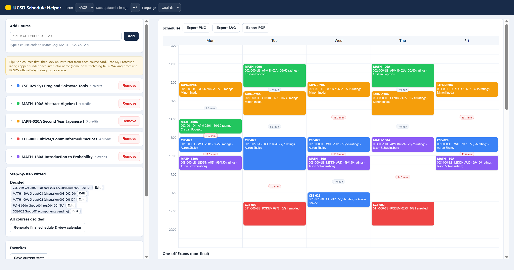

# UCSD Schedule Helper (UCSD 排课助手)

[中文](README.zh-CN.md) | **English**

The new TSS system has made course planning painful for many students, and the school's official planner is... okay at best. So I built my own planner that satisfies my needs. I used this tool to plan my own Fall 2026 schedule — it works, it is genuinely useful, and I hope it helps you too.

A local-first course scheduling tool for UCSD students. It pulls real section data from UCSD Class Planner, walks you through lecture/discussion choices, generates conflict-free schedules, and can ask DeepSeek for advice — through a local web interface. UCSD sign-in is required to load current courses.



## Features

- **Real UCSD data** — sections, times, rooms, instructors, and seats from UCSD Class Planner / TSS
- **Step-by-step wizard** — pick a lecture first, then discussion/lab; the calendar updates live and conflicts show alternatives
- **All-schedules mode** — generates conflict-free combinations within a search budget; compare, save, and export
- **Rate My Professor** — ratings shown next to instructor names (best-effort fetch)
- **Walking estimates** — between buildings using UCSD official Wayfinding routes, with a fallback
- **Final exams** — shown on a separate date-based calendar
- **Dynamic calendar** — starts about 1 hour before your first class instead of wasting space from 7:00
- **DeepSeek Q&A** — the current schedule and full section details are attached automatically
- **Light/dark theme** and **中文/English**, both persisted
- **Export** — PNG / SVG / PDF with a print-friendly layout
- **Local drafts** — keep a separate saved draft for each term

## Quick start on Windows

1. Install Python 3.10 or later and enable **Add Python to PATH**.
2. Run `安装登录组件.bat` to install Playwright and Chromium.
3. Run `start.bat` and open <http://127.0.0.1:8778/>.
4. Click the UCSD sign-in button. Complete sign-in and Duo in the dedicated browser window and keep it open.
5. Select a term and enter a course code such as `MATH 20D`.

The term list comes from UCSD Class Planner. FA26 and WI27 were verified in live course queries in November 2026. The helper saves a separate draft for each term. Saved drafts can be viewed offline.

## How to Use

1. **Add courses** — type a code like `MATH 100A`, `CSE 29`, or `JAPN-020A` (spaces and dashes are optional), pick from the dropdown or press Enter, then click Add.
2. **Wizard mode** (default) — the wizard suggests the course with the fewest feasible sections first, then you decide one course at a time: lecture → discussion/lab. The calendar preview shows your chosen blocks; confirm to move on, or click "edit" next to a decided course to change it.
3. **All-schedules mode** — switch to it under "Advanced" on the left, optionally lock instructors or show only open sections, then generate conflict-free combinations within a search budget; browse them, compare up to 3, or pin/fix sections.
4. **View the calendar** — below the week grid are walking-time hints and a date-based final-exam calendar; details include a daily walk breakdown and one-off exams (e.g., midterms).
5. **Export** — top-right: PNG / SVG / PDF with the schedule title, week grid, and final exams.
6. **DeepSeek** (optional) — ask "is this schedule too heavy?"; the LLM considers all course info and class combinations, with answers streamed and auto-saved to local chat history.
7. **Favorites** — "Save current view" remembers your courses, wizard progress, and current schedule; click "Load" to resume.

Courses, wizard progress, favorites, and chat history auto-save to `saved_data.json` in the same folder. Delete that file to reset.

## DeepSeek AI (Optional)

Get an API key at [platform.deepseek.com](https://platform.deepseek.com). The key stays in page memory and is sent with your AI requests to DeepSeek.

## Data and privacy

- The local server listens on `127.0.0.1`. The dedicated browser handles UCSD authentication. Windows DPAPI encrypts the saved session under `%LOCALAPPDATA%/UCSD-Schedule-Helper/`.
- Use the local sign-in controls to reconnect or clear the saved session. For certificate errors, check your network and certificate settings.
- Drafts, favorites, and AI history are stored in `saved_data.json`. Exclude that file and backups when sharing the project.
- Optional DeepSeek features send the key, question, and relevant course or schedule data to DeepSeek. The key stays in page memory between requests.
- Instructor ratings and walking estimates use Rate My Professor and UCSD Wayfinding.

## Project Structure

```
scheduler.py   Local HTTP server and scheduling engine
ucsd_session.py  UCSD sign-in and authenticated requests
private_state.py Windows DPAPI session encryption
requirements.txt Playwright dependency
index.html     Single-page UI (vanilla HTML/CSS/JS, no build step)
start.bat      Windows launcher (port 8778)
README.md      This file
```

## Tech Stack

- Python 3.10+ and Playwright with Chromium for UCSD sign-in
- Vanilla HTML/CSS/JS

## Troubleshooting

- **SSL certificate errors** — check your proxy, network, or certificate settings.
- **No feasible schedule** — remove instructor locks or the "only open sections" filter, or drop a course.
- **Port already in use** — run `python scheduler.py --port 9000`.
- **PDF colors look gray** — if your browser still strips backgrounds, enable "Background graphics" in the print dialog.
- **Generation too slow** — turn off "estimate walking time" for a big speedup; be patient with the progress bar when there are many combinations.
- **Browser didn't open** — visit `http://127.0.0.1:8778/` manually.
- **Term list is empty** — sign in to UCSD and use the connection check to reload the official term list.

## Disclaimer

Not affiliated with or endorsed by UC San Diego. Course data comes from UCSD Class Planner / WebReg and may change — always verify on WebReg/TSS before enrolling. Rate My Professor data is third-party and best-effort.

## License

MIT
