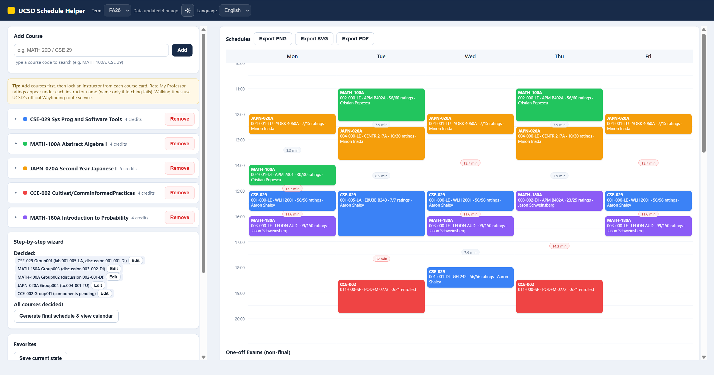

# UCSD 排课助手（UCSD Schedule Helper）

[English](README.md) | **中文**

TSS 系统的加入让众多学生苦不堪言，学校官方的 planner 体验感觉也一般般，所以我就自己做了一个符合我选课流程、对我有用的工具。26Fall 的选课我就是用这个工具排自己课表的，亲测能用、好用，希望对大家也有用处。

一个本地优先的 UCSD 选课排课工具：从 UCSD Class Planner 拉取真实分班数据，通过向导逐步确定正课/讨论，生成不冲突的课表组合，还可以让 DeepSeek 帮你参谋。界面在本机运行，加载最新课程数据需要登录 UCSD。



## 功能

- **真实 UCSD 数据** — 分班、时间、教室、老师、剩余座位，来源为 UCSD Class Planner / TSS
- **逐门向导** — 先定正课，再选讨论/实验；日历实时预览，冲突时给出替代方案
- **全部方案模式** — 在计算预算内生成不冲突的组合，支持对比、保存和导出
- **Rate My Professor** — 老师名下直接显示评分（尽力抓取，失败时只显示名字）
- **步行时间估算** — 使用 UCSD 官方 Wayfinding 路线，失败时自动降级
- **期末考试** — 单独的按日期日历展示
- **动态时间轴** — 课表从第一节课前一小时左右开始，不再从 7:00 白白留白
- **DeepSeek 问答** — 自动附带当前课表和完整分班信息
- **白天/黑夜主题** 与 **中文/English**，都会记住你的选择
- **导出** — PNG / SVG / PDF，打印排版友好
- **本地草稿** — 分学期保存课表

## Windows 快速开始

1. 安装 Python 3.10 或更新版本，并勾选 **Add Python to PATH**。
2. 运行 `安装登录组件.bat`，安装 Playwright 和 Chromium。
3. 运行 `start.bat`，打开 <http://127.0.0.1:8778/>。
4. 点击 **登录 UCSD**，如果弹出专用窗口，在里面完成 UCSD 登录和 Duo。验证成功后窗口会关闭，助手继续在后台查课。重启助手后，点击登录按钮可尝试恢复会话。
5. 选择学期，输入课程代码，例如 `MATH 20D`。

学期列表来自 UCSD Class Planner。2026 年 11 月已实测 FA26 和 WI27 的课程查询。不同学期分别保存草稿，已有草稿可离线查看。

## 使用方法

1. **添加课程** — 输入类似 `MATH 100A`、`CSE 29`、`JAPN-020A` 的代码（带不带空格、连字符都行），从下拉提示里选中或直接回车，然后点"添加"。
2. **逐门向导**（默认模式）— 左边会按"可行班最少的课优先"的顺序推荐，一门一门定：正课 → 讨论/实验。日历预览实时显示你选的分班，确认后再进入下一门；想改任何一门课，点已决定课程旁边的"改"。
3. **全部方案模式** — 在左边"高级"里切换到全部方案模式，可以锁定老师或只看空位，再点"生成全部可行课表"；生成后逐个浏览，最多对比 3 个，也可以固定某些分班。
4. **看课表** — 周历下方有课间步行提示和期末考试（按日期）日历；详情里有每天步行明细和非期末的一次性考试（如 midterm）。
5. **导出** — 右上角可导出 PNG / SVG / PDF，包含课表标题、周课表和期末考试。
6. **DeepSeek**（可选）— 问"这个课表会不会太累？"，程序会自动带上时间、教室、老师、RMP、座位和期末考试信息；回答会流式显示并自动保存到本地对话记录。
7. **收藏** — "保存当前界面"会记住你的课程、向导进度和当前课表，下次点"加载"就能恢复。

课程、向导进度、收藏和对话记录会自动保存到同目录的 `saved_data.json`。删除该文件即可重置。

## DeepSeek AI（可选，别问为什么是deepseek因为梁圣nb）

在 [platform.deepseek.com](https://platform.deepseek.com) 获取 API Key。Key 保存在页面内存中，发起 AI 请求时会发送给 DeepSeek。

## 数据与隐私

- 服务只监听 `127.0.0.1`。登录在专用浏览器中完成，Chromium 专用配置位于 `%LOCALAPPDATA%/UCSD-Schedule-Helper/browser-profile/`。
- 可重新登录，或清除专用浏览器配置及其中的登录数据。证书报错时请检查网络和证书设置。
- 草稿、收藏和 AI 对话保存在 `saved_data.json`。分享时请排除该文件及本地备份。
- 可选的 DeepSeek 功能会将 API Key、问题及相关课程或课表发送给 DeepSeek。Key 在请求之间保存在页面内存。
- 老师评分和步行估算使用 Rate My Professor 和 UCSD Wayfinding。

## 项目结构

```
scheduler.py   本地 HTTP 服务和排课引擎
ucsd_session.py  UCSD 登录与认证请求
private_state.py 迁移旧版 Windows DPAPI 会话
requirements.txt Playwright 依赖
index.html     单页界面（原生 HTML/CSS/JS，无构建步骤）
start.bat      Windows 启动器（端口 8778）
README.md      英文说明
README.zh-CN.md 中文说明（本文件）
```

## 技术栈

- Python 3.10+，使用 Playwright 和 Chromium 登录 UCSD
- 原生 HTML/CSS/JS

## 常见问题

- **SSL 证书报错** — 请检查代理、网络或证书设置。
- **没有可行方案** — 去掉"锁定老师"或"只看空位"筛选，或者少选一门课。
- **端口被占用** — 运行 `python scheduler.py --port 9000`。
- **导出的 PDF 颜色发灰** — 如果浏览器仍然去掉背景色，请在打印对话框勾选"背景图形"。
- **生成太慢** — 取消"估算步行时间"会快很多；组合特别多时耐心等进度条。
- **浏览器没自动打开** — 手动访问 `http://127.0.0.1:8778/`。
- **学期列表为空** — 登录 UCSD 后点击「检查连接」，重新读取官方学期列表。

## 免责声明

本项目与加州大学圣迭戈分校（UC San Diego）无关，也未获得其认可。课程数据来自 UCSD Class Planner / WebReg，可能随时变化——选课前请务必以 WebReg / TSS 为准。Rate My Professor 数据来自第三方，仅尽力而为。

## 许可证

MIT
